<a href="https://www.abdulelah.de">
  <picture>
    <source media="(max-width: 600px)" srcset="assets/terminal-mobile.svg">
    
  </picture>
</a>

###### SELECTED WORK

<samp>01</samp>&ensp;**[Raqmi](https://github.com/Abdulel3h/llm-application-engineering-Raqmi)** — Bilingual retail-support agent. The model proposes; code authorizes.

<samp>02</samp>&ensp;**[ChatUB](https://github.com/Abdulel3h/ChatUB)** — Arabic university assistant on local retrieval and a local model.

<samp>03</samp>&ensp;**[Abdulelah.de](https://github.com/Abdulel3h/Abdulelah)** — Live bilingual portfolio with an assistant grounded in typed facts.

###### CONNECT

[abdulelah.de](https://www.abdulelah.de)&ensp;·&ensp;[LinkedIn](https://www.linkedin.com/in/abdulelahalkhathami)&ensp;·&ensp;[Email](mailto:me@abdulelah.de)
